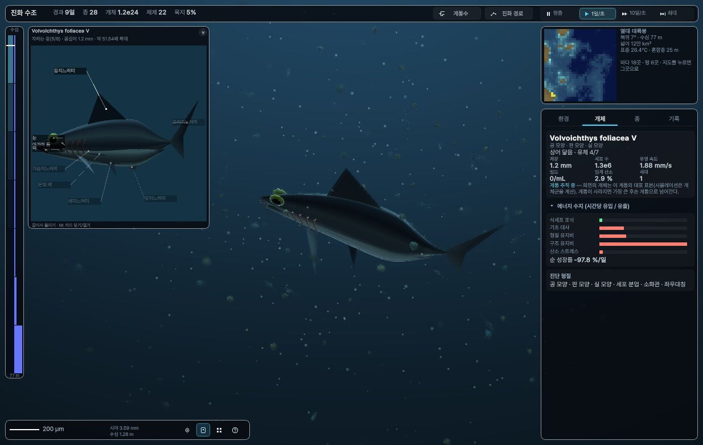
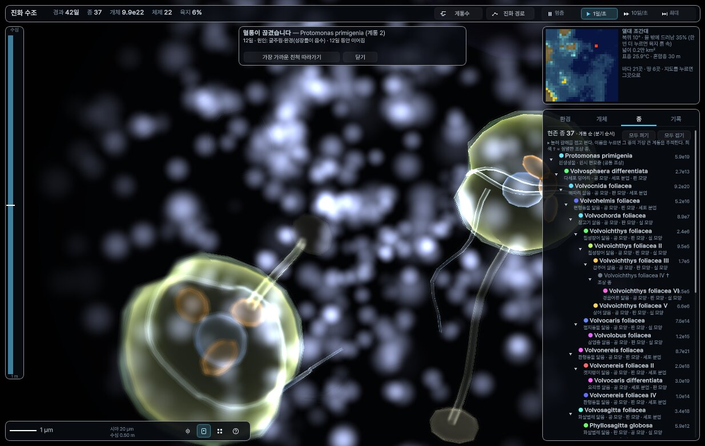
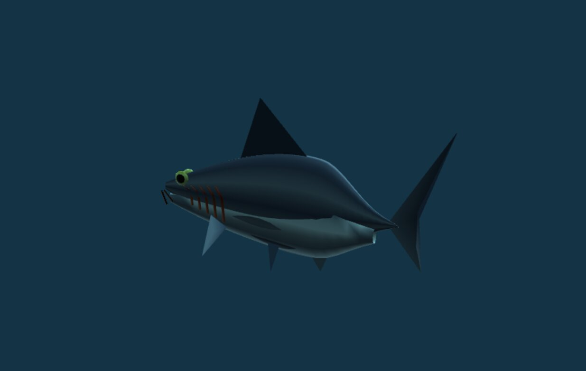
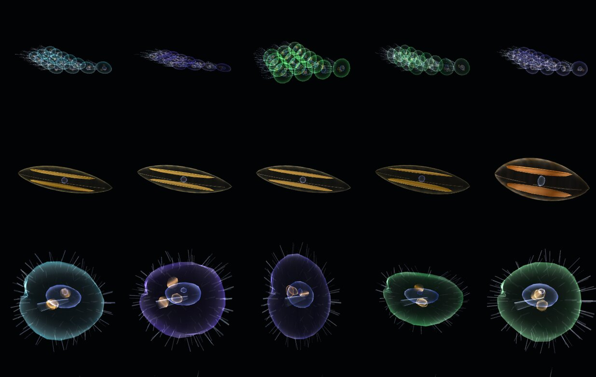

# 진화 수조 (EvoTank)

바다 행성의 물속을 μm에서 m 크기까지 헤엄치며 생물이 진화하는 모습을 지켜보는 시뮬레이션입니다. 처음엔 단세포뿐이지만, 대륙이 자라는 동안 군체·다세포·육상 생물이 스스로 갈라져 나옵니다. 정해 둔 목표 생물군은 없습니다. 설계에서 정하는 것은 물리·화학·생태 규칙뿐이고, "절지동물 닮음" 같은 이름은 나온 결과에 붙이는 이름표입니다.

<p align="center">
  <a href="https://github.com/dhsrua555/evo-tank-unity/releases/download/v0.1.2/EvoTank-v0.1.2-Android.apk"></a>
  <a href="https://github.com/dhsrua555/evo-tank-unity/releases/download/v0.1.2/EvoTank-v0.1.2-Linux.tar.gz"></a>
</p>
<p align="center"><sub>v0.1.2 사전 배포판 · Android 8.0 이상(64비트 ARM) · <a href="https://github.com/dhsrua555/evo-tank-unity/releases">모든 배포판</a></sub></p>

<p align="center"></p>

<table>
  <tr>
    <td width="50%"><br><sub>종이 갈라지는 계통수 (<code>G</code>)</sub></td>
    <td width="50%"><br><sub>μm 크기로 들여다본 군체</sub></td>
  </tr>
  <tr>
    <td><br><sub>종을 돌려 보는 확대 카드 (<code>M</code>)</sub></td>
    <td><br><sub>부모 종과 자식 종의 생김새</sub></td>
  </tr>
</table>

## 설치

**Android**
1. 휴대폰에서 위의 **APK 내려받기** 단추를 누릅니다.
2. 받은 파일을 엽니다. 처음이면 브라우저(또는 파일 앱)에 "출처를 알 수 없는 앱 설치"를 허용해 달라고 묻습니다.
3. Play 프로텍트 경고가 뜨면 "세부정보 → 무시하고 설치"를 누릅니다. 플레이 스토어 밖에서 받은 앱이라 뜨는 경고입니다.

**Linux** (x86_64)
```sh
tar xzf EvoTank-v0.1.2-Linux.tar.gz
./EvoTank/EvoTank.x86_64
```

## 조작

| 하는 일 | PC | 휴대폰 |
|---|---|---|
| 둘러보기 | 끌기 | 한 손가락 끌기 |
| 헤엄 | `WASD`, `E`/`Q` 위·아래, `Shift` 빠르게 | 두 손가락 함께 끌기 |
| 관찰 축척(μm ↔ m) | 휠 | 두 손가락 벌리기·오므리기 |
| 개체 고르기 | 클릭 | 누르기 |
| 창 닫기·고르기 풀기 | `Esc` | 뒤로 |
| 계통수 · 진화 경로 | `G` · `T` | 화면 단추 |
| 확대 카드 · 표본 쟁반 | `M` · `P` | 화면 단추 |
| 멈춤 · 속도 | `Space` · `1`–`4` | 화면 단추 |

휴대폰 화면은 PC 화면 배치를 줄여 쓰기 때문에 글자가 작습니다. 태블릿이 더 보기 편합니다.

## 무엇을 계산하나

- **세계:** 32×32칸 지도(위도 2–60°N)를 수심대·위도대별 해역으로 묶고, 12층 물기둥으로 계산합니다. 위도대마다 조간대와 육지(흙 속 물막)도 있습니다.
- **지구 시스템:** 탄소(화산 ↔ 풍화·매몰), 기온, 빙상, 해수면, 대기 산소가 움직입니다. 화산·운석·융기·빙하기 같은 자연현상을 직접 일으킬 수도 있습니다.
- **원시 바다:** 처음엔 지표의 5%만 드러난 바다 행성입니다. 조산대 세 곳이 옮겨 다니며 지각을 올려 약 1500일에 걸쳐 대륙이 자랍니다(`P.PRIMO`, `P.CRUST_T`).
- **생태:** 크기 규칙에 따른 포식·섭식, 그리고 사체 → 유기물 → 세균 → 영양염으로 이어지는 물질 순환을 계산합니다. 다양성을 지키는 힘으로 종별 바이러스(kill-the-winner), 포식자의 먹이 전환, 혼합영양 손익, 식물성 플랑크톤 삼출(미생물 고리), 단세포의 수평 유전자 전달, 군체의 확산 경계층 겹침을 넣었습니다.
- **진화:** 유전자 44개(세포 크기·광합성·체절·외골격·턱·마름 견디기 …)가 있습니다. 돌연변이는 침입 성장률이 0보다 클 때만 정착합니다.
- **화면:** 몸은 부품 유전자 조합대로 그려집니다. 종마다 물려받는 형태 표지(몸 비율·무늬·색·부속지 수)가 있어서, 몸 설계가 같아도 종이 다르면 모양이 다릅니다. 무거운 계산은 뒤 스레드에서 돌아 화면이 멈추지 않습니다.

## 직접 빌드하기

- Unity 6000.6.6f1에서 이 폴더를 엽니다(장면: `Assets/Main.unity`).
- 빌드: `./build.sh [Linux|Win|Android]`. Android는 IL2CPP·ARM64 APK로 나옵니다.
- 화면 점검 캡처: `./shots.sh <태그> [-gallery]`. 두 스크립트 모두 Unity가 `~/Unity/Hub/Editor/6000.6.6f1`에 있다고 가정합니다.
- 개발자용 화면: 실행할 때 `-dev`를 붙이면 수치 조정·유전자 값·계산 통계가 함께 보입니다. `EVOTANK_DEV` 정의를 넣고 빌드해도 같습니다.
- 시뮬레이션 코어(`Assets/Scripts/Sim`)는 Unity 없이도 돕니다: `cd SimTest && dotnet build -c Release && ./run.sh control <일수> <시드> <출력 간격>`.

| 경로 | 내용 |
|---|---|
| `Assets/Scripts/Sim/Sim.cs` | 유전자·매개변수·에너지 수지·이동·물질 순환·돌연변이 |
| `Assets/Scripts/Sim/Geo.cs` | 지도·해역·조간대·육지 |
| `Assets/Scripts/Sim/Earth.cs` | 지구 시스템·자연현상 |
| `Assets/Scripts/Sim/Taxa.cs` | 몸 설계 자동 분류·이름 |
| `Assets/Scripts/View/` | 화면(헤엄·몸 그리기·확대 카드·계통수·UI) |
| `Assets/Editor/EvoBuild.cs` | 명령줄 빌드(판 번호는 여기서 바꿉니다) |
| `SimTest/` | 화면 없이 돌리는 시험·탐침 |
| `PLAN.md`, `docs/` | 개편 계획, 근거 자료 정리 |

글꼴 Pretendard는 SIL Open Font License 1.1을 따릅니다(`Assets/Resources/Fonts/Pretendard-OFL.txt`).
