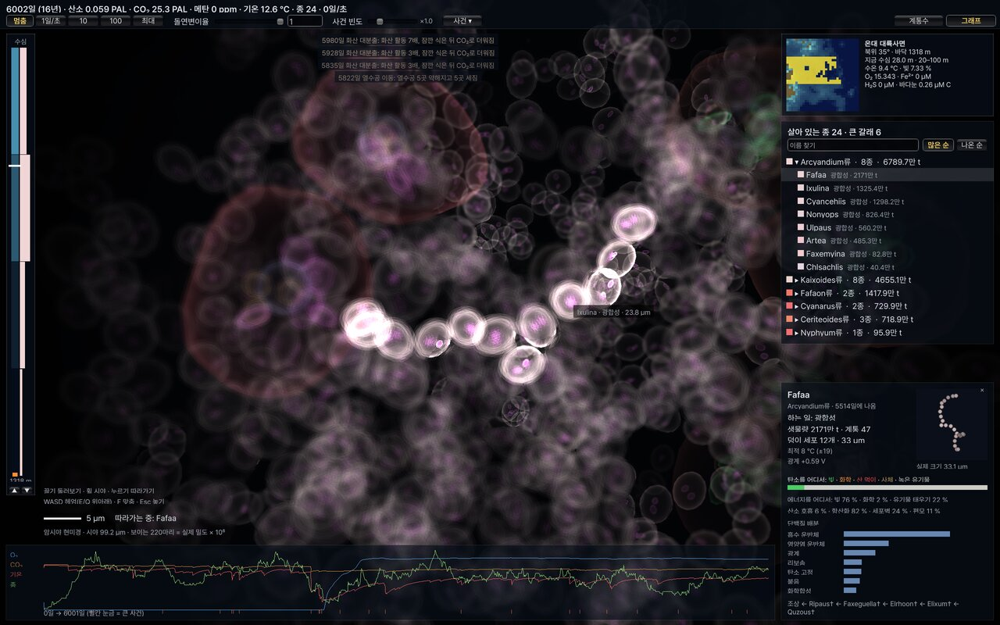
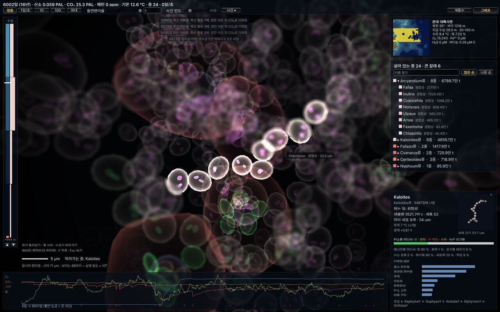
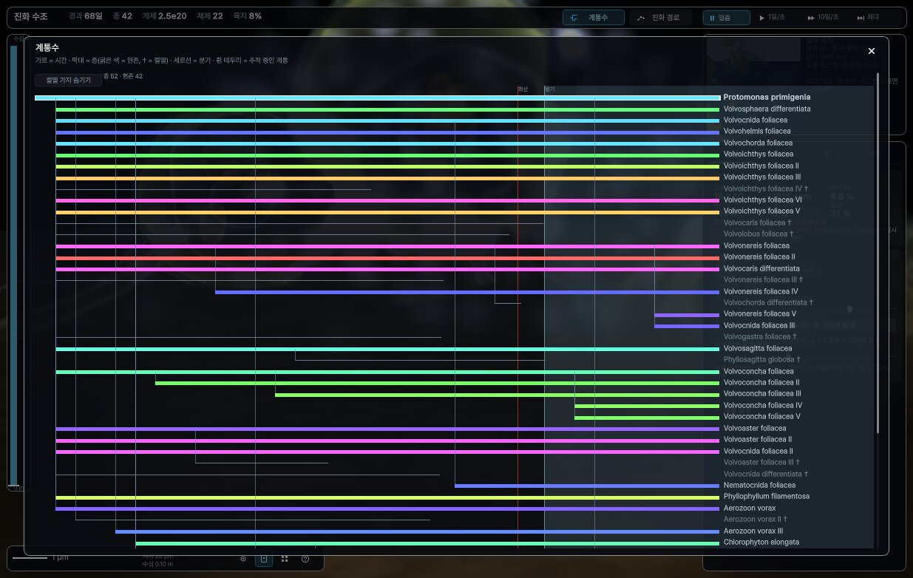

# 진화 수조 (EvoTank)

원시 지구의 바다에서 세포가 스스로 진화하는 모습을 지켜보는 시뮬레이션입니다. 처음엔 열수공 곁에서 수소와 CO₂로 사는 1 μm 무산소 세포 한 종뿐입니다(첫 공통 조상 재구성, Weiss 2016·Moody 2024). 그 세포엔 광합성·산소 호흡·편모·포식이 없고, 돌연변이가 넓혀 갈 아주 작은 출발점만 있습니다(근거는 `Life/01_Genome.cs`의 Primordial). 광합성, 산소를 내는 광합성, 포식자, 사체를 먹는 청소부, 녹은 유기물을 분해하는 세균, 세포가 붙은 덩이(다세포)는 모두 정해 두지 않았습니다. 설계에서 정하는 것은 세포 생리·화학·물질 장부(탄소·질소·인·철·황) 규칙뿐이고, 역할 이름은 나온 결과에 붙이는 이름표입니다.

> 2026-11 판(v0.2 개발 중)은 시뮬레이션을 처음부터 다시 만든 것입니다. 옛 판(v0.1.x, 물고기·육상 생물까지 가는 몸 설계 방식)은 [배포판](https://github.com/dhsrua555/evo-tank-unity/releases)에 남아 있습니다.

화면 전체가 한 해역의 물속입니다. 관찰자가 그 물기둥 안을 헤엄치며 둘레 상자 안의 세포를 봅니다. 상자 안 개체 수는 그 칸의 실제 밀도 × 상자 부피 × 농축 배율입니다. 시야가 2 mm보다 작으면 암시야 현미경처럼, 크면 물속처럼(햇빛·물빛·빛물결·바다눈) 보입니다. 세포 모양은 미리 정한 그림이 아니고 형질에서 나옵니다: 세포막·세포벽, 광계 알갱이(산소 광합성은 청록, 아니면 자주), 황 알갱이, 산화철 껍질, 먹이 주머니, 편모, 덩이 배치.

<table>
  <tr>
    <td width="50%"> 6000일: 세포가 붙은 사슬 덩이와 크고 작은 세포들(처음 세포엔 편모가 없고, 헤엄은 나중에 진화한다)</td>
    <td width="50%"> 계통수: 살아 있는 종과 그 조상(멸종 †)</td>
  </tr>
</table>

## 조작

| 하는 일 | PC | 휴대폰·태블릿 |
|---|---|---|
| 시야 넓히기·좁히기 | 휠 | 두 손가락 벌리기·오므리기 |
| 둘러보기 | 끌기 | 한 손가락 끌기 |
| 헤엄 | WASD(E/Q 위아래, Shift 빠르게), PageUp/Down 0.5 m | 두 손가락 함께 끌기 |
| 개체 따라가기 | 세포 클릭 또는 오른쪽 종 목록(그 종이 가장 많은 칸으로), Esc 놓기, F 몸에 맞춤 | 누르기 |
| 다른 해역·수심 | 오른쪽 위 지도 · 왼쪽 수심계 누르기(▲▼ 한 층) | 같음 |
| 속도 | 위 단추(멈춤 · 1 · 10 · 100일/초 · 최대) | 같음 |
| 돌연변이율 | 위 막대 또는 칸에 숫자(1e-4 ~ 10) | 같음 |
| 사건 일으키기 | `사건 ▾` → 화산 · 소행성 · 빙하기 · 열수공 · 메탄 분출 · 산맥 솟음 · 바다 뒤집힘(사건마다 무엇이 바뀌는지 설명이 붙어 있음) | 같음 |
| 새 지구 | `사건 ▾` 맨 아래 `새 지구로 시작`을 두 번(4초 안에) | 같음 |
| 계통수 · 그래프 | 위 오른쪽 단추 | 같음 |

- 종 목록은 살아 있는 종만, 큰 갈래로 접어서 보여 줍니다. 검색칸에 이름을 넣으면 펼친 목록으로 찾습니다. `많은 순`/`나온 순`으로 정렬합니다.
- 시뮬레이션은 화면과 따로 도는 스레드라서 PC에서는 창을 내리거나 다른 작업 공간으로 가도 계속 갑니다. 휴대폰·태블릿은 앱이 멈춰 있던 시간만큼 다시 열 때 최대 속도로 따라잡습니다(최대 3만 일). 따라잡는 동안은 물속을 그리지 않고 그 몫을 계산에 씁니다.
- 진행은 저절로 저장됩니다(2분마다, 앱을 내리거나 끌 때). 다시 열면 그 지구를 이어서 돌립니다. 저장 형식이 바뀐 판에서 옛 파일을 못 읽으면 `earth.sav.old`로 남기고 새 지구로 시작합니다.

## 무엇을 계산하나

- **바다:** 위도·지형으로 나눈 해역마다 4층(표층 · 20–100 m · 100–500 m · 심해)과 열수공 칸. 칸마다 CO₂·O₂·H₂·CH₄·Fe²⁺·Fe³⁺·H₂S·SO₄²⁻·NH₄⁺·PO₄³⁻·녹은 유기물·사체(크기 셋)를 μM으로 셉니다. 섞임·가라앉음·기체 교환·매몰을 거쳐도 원소 장부가 맞는지 매일 확인합니다. 전자(산화환원)도 장부로 맞춥니다: 모든 반응이 전자를 지켜서, 행성 전체의 환원력은 열수공·화산·산화 풍화로 들어온 만큼과 매몰·수소 탈출로 나간 만큼으로만 바뀝니다(받개 없는 산화는 없음 — 황화수소·철을 먹는 세포는 산소가 있어야 돌고, 화학합성 세포가 고정에 쓴 전자는 받개로 가지 않습니다).
- **세포:** 유전자는 단백질 배분(리보솜·광계·탄소 고정·화학합성·흡수·포식 막·산소 호흡·항산화·편모·붙음·세포벽·질소 고정 …)과 연속 형질(광계 산화력, 최적 온도, 세포 크기·모양, 덩이 배치)입니다. 성장률은 그 배분으로 ATP·전자·탄소·질소·인 수지를 풀어 냅니다. 따로 정한 적합도 점수는 없습니다. 암모늄·인산 운반체는 유기물 운반체와 다른 단백질입니다. 큰 세포는 색소끼리 가려 빛을 덜 씁니다(묶음 효과, Morel & Bricaud 1981: 10 μm 0.83, 100 μm 0.28). 덩이 크기는 세포 수에 따라 끊김 없이 커집니다(붙음 단백질을 조금 늘리면 몸도 조금). 영양분은 세포 둘레로 확산해 들어오고(4πDrC), 운반체와 확산이 직렬로 막습니다. 덩이 안의 세포는 이웃과 같은 물을 나눠 써서 한 세포 몫이 줄어듭니다(Kirkwood 근사로 몸의 확산 반지름을 셈: 20세포 곧은 실 0.32, 같은 수의 덩어리 0.17). 같은 반지름이 가라앉는 끌림도 정합니다(Hubbard & Douglas 1993). 안쪽 세포는 바이러스를 덜 만납니다. 몸 속 세포는 겉에서 스며드는 산소만 씁니다(몸을 공으로 보고 확산·소비를 풂: 동물 조직이면 산소 10 % PAL에서 두께 약 1 mm — Payne 2009 PNAS 106:24와 같음, `OXCAL=1`로 확인). 산소가 모자란 속 핵은 발효만 합니다. 실·덩이에서 분화한 세포는 이형세포가 됩니다: 광계 II가 없어 산소를 안 만들고 외피가 바깥 산소를 막아(Walsby 1985) 그 안에서 질소를 고정합니다.
- **산소:** 광계 산화력이 물의 전위(+0.82 V)에 가까워질수록 물을 전자 공여체로 쓰고 산소가 나옵니다. 산소 호흡은 O2 0.1 μM에서 반쯤 돌고(해양 군집 실측 10–200 nM, Tiano 2014), 호흡 단백질 몫에 비례하는 속도까지만 산소로 태우며 넘치는 유기물은 발효합니다(넘침 대사, Basan 2015: 몫 1당 유기 C 120/일). 산소는 철·황화수소·메탄을 산화시키고, 세포 안에서는 활성 산소로 해를 줍니다(항산화로 막음). 산소가 약 1e-2 PAL을 넘으면 오존이 자외선을 막습니다. 바닷물의 Fe²⁺와 황화물이 용해도곱(매키나와이트, Rickard 2006)을 넘으면 황화철로 가라앉아 묻힙니다(황철석 매몰 = 황의 주 출구, Berner 1984). 땅에 드러난 옛 암석의 유기 탄소·황철석은 산소에 녹아 나옵니다(산화 풍화, 속도 ∝ O2^0.5 — Williamson & Rimstidt 1994; 1 PAL 기준 지구 값 유기 탄소 68 Mt C/년 Zondervan 2023, 황철석 1.3 Tmol S/년 Burke 2018). 산소가 오르면 바다로 들어오는 황산이 늘어납니다. 묻히는 유기물의 C:P는 바닥 물 산소를 따라 60(산소 있음)–200(없음)입니다(Algeo & Ingall 2007): 산소 없는 바닥은 인을 물로 되돌리고, 산소 있는 바닥은 붙잡아 같이 묻습니다. 표층 산소가 약 7 % PAL에 머무는 것은 되돌아가는 끌개가 아니라 쌓인 양입니다: 깊은 바다의 H₂S·Fe²⁺가 내려오는 산소를 먹고, 순 산화(묻힘 − 환원 기체 공급, 약 2e10 mol/일)가 바다 전체를 1 PAL 몫(2.7e16 mol) 채우려면 약 1e6일이 걸립니다(원생누대의 '지루한 10억 년'과 같은 꼴). 바다의 인은 풍화 공급의 약 1300만 일 치라 인 공급 손잡이도 아주 느리게 듣습니다. 광합성만 늘리면 호흡·분해가 그만큼 태웁니다. 산소를 1 PAL로 채운 시험에서도 몸 크기·다양성은 늘지 않았습니다(지금 다양화를 막는 것은 산소가 아님).
- **생태:** 크기 비례 포식(즐겨 먹는 먹이 크기 비는 유전자 — 같은 크기에서 1/20까지, Hansen 1994. 분화 없는 덩이는 세포 하나 크기로 먹고 분화할수록 몸 전체로 먹으며, 먹는 크기의 1.2배까지 감싸 먹음, 같은 종은 안 먹음). 몸 탄소당 최대 섭취는 먹는 크기가 클수록 느리지만(세포 하나 크기까지는 부피^−0.23, Hansen 1997; 세포를 넘는 몫은 아래 몸 시계와 같은 −0.12), 걸러 먹는 양(만남)은 거의 줄지 않습니다(지름^−0.20): Kiørboe & Hirst 2014 모음(PANGAEA 819856)을 다시 맞추면 원생생물 탄소당 최대 청소율 ∝ 질량^−0.07±0.06(61건), 원생생물~어류 871건 전체는 14자리 내내 300–500 ml/mg C/h, 최대 섭취는 질량^−0.22±0.04로 예전 값과 같습니다. 예전엔 둘 다 −0.23이라 먹는 크기 100 μm 포식자의 청소가 자료의 1/4이었습니다. 고친 뒤 10000일 16시드: 최대 크기 198 → 330 μm(t +2.1), 형태 불일치 9.6 → 12.5(t +1.6), 영양 단계는 그대로(최고 2.45 → 2.46). 같은 자료에서 물고기·해파리는 같은 질량 갑각류보다 탄소당 청소가 7–33배(호흡은 비슷)라 '감각 기관' 유전자(분화한 몸의 만남이 크기로 줄지 않음, 유지비 ~20 %)를 시험했지만 분화가 낮아(평균 0.09) 쓰이지 않았고 영양 단계·다양성 변화가 없어(최고 2.46 vs 2.44) 넣지 않았습니다. 먹이 바꿔 먹기(종 단위 KTW α=2, Vallina 2014: 섭취 몫 ∝ 종별 먹을 양², 총 섭취 그대로)도 시험했지만 종 수만 늘고(83 → 95, t +2.9) 실효 종 수는 잡음 안(36 → 41, t +1.2), 형태 불일치는 줄고(12.5 → 8.6, t −1.7) TL 2.5 넘는 생물량이 줄었으며(2.6 → 0.5 %, t −2.4) 속도가 반이라 넣지 않았습니다. 삼켜 먹는 몸(포식 막)이 분화해 한 몸이 되면 모든 생리 속도(빛·흡수·호흡·고정·리보솜·유지비·자연 사망)가 섭취와 같은 지수로 느려집니다(몸 시계 — 대사 이론의 속도 ∝ 크기 항 × 온도 항, Gillooly 2001; 후생동물 대사 지수 0.76–0.79, DeLong 2010; 광합성 몸은 질량에 거의 비례해 시계 없음, Reich 2006). 세포보다 큰 몫(분화한 몸)의 지수는 생활형 안 기울기를 씁니다: 같은 Kiørboe & Hirst 자료를 생활형별로 맞추면 후생동물(갑각·살파·어류·화살벌레·해파리) 몸 탄소당 최대 섭취 질량^−0.13(290건), 호흡 −0.12(1128건)으로 원생생물 섭취(−0.22)보다 완만합니다(DeLong의 0.76–0.79는 생활형 사이 높이 차가 섞인 값). 지름^−0.69 → −0.37로 바꾼 뒤 10000일 16시드: 평균 영양 단계 1.82 → 1.89(t +2.0), 분화 평균 0.08 → 0.12(t +1.9), 형태 불일치 12.5 → 15.1(t +1.1), 최대 크기 330 → 435 μm(t +1.0), 종 수는 그대로(83 vs 80). 큰 분화 포식자 사망의 70–80 %가 바이러스(먹힘 0)라 바이러스 사망에도 몸 시계를 곱해 봤지만(야외 자연 사망 ∝ 질량^−1/4, McCoy & Gillooly 2008) 16시드에서 분화 0.12 → 0.17(t +1.8) 말고는 모두 잡음 안(최대 크기 435 → 537 μm t +0.9, 영양 단계 그대로, 실효 종 36 → 33 t −1.2)이고 병이 숙주 대사를 따른다는 직접 근거를 찾지 못해 넣지 않았습니다. 섭취만 줄고 비용이 그대로면 큰 포식자는 늘 굶고, 비용만 줄이면 큰 혼합 영양 포식자가 광합성으로 공짜 이득을 봅니다(시험에서 맨 위 포식자가 10 → 44세포로 부풀었던 것이 이것). 10000일 16시드에서 몸 꼴·다양성은 대조와 같고(형태 불일치 9.6 vs 9.5), 최대 크기 204 vs 157 μm는 잡음 안입니다. 사체 먹기, 녹은 유기물 흡수(녹은 유기물은 탄소·에너지만 주고, 세포가 터지거나 사체가 녹을 때 질소·인은 바로 무기염으로 간다), 종별 바이러스(kill-the-winner). 역할은 하루 수입으로 붙입니다: 먹은 탄소가 1/3을 넘으면 포식·청소, 아니면 주 에너지원(빛·화학·유기물 태우기)으로 광합성·화학합성·분해.
- **진화:** 분열마다 돌연변이가 생기고(공급 = 분열 속도 × 개체 수 × 돌연변이율), 틱마다 후보를 같은 생리 식으로 부모와 비교해 Kimura 정착 확률로 남깁니다. 한 번에 바뀌는 몸 모양은 작아서(세포 크기 한 걸음 ≈ 11 %) 모양이 갑자기 바뀌지 않습니다. 종은 처음 생긴 계통(창시자)과의 거리로 묶어 사슬처럼 이어지지 않습니다. 따로 세는 계통은 320개까지입니다: 선택 계수가 표류 장벽(1/N)을 넘고 그 칸에서 스스로 늘 수 있는(r > 0) 변이만 새 계통이 되고, 칸이 모자라면 늘지 않는 계통 중 작은 것부터 부모·친척 계통에 합칩니다(지운다고 죽이지 않음). 정착한 변이는 부모 생물량의 30 %로 시작합니다(지역 집단에서 이미 번진 몫). 표류 장벽 밑의 변이(|s| < 1/N)는 버리지 않고 정착 확률(중립이면 1/N)로 부모 계통의 유전체를 통째로 바꿉니다(중립 표류, Kimura). 그래서 몸 꼴 유전자도 떠돌다 다른 꼴의 문턱을 넘습니다(`NODRIFT=1`이면 끔).
- **지구:** 기온은 CO₂·CH₄ 온실 효과와 어두운 젊은 태양으로 정해지고, 화산 대분출 · 소행성 충돌 · 빙하기 방아쇠 · 열수공 이동 · 메탄 분출 · 산맥 솟음 · 바다 뒤집힘이 거듭제곱 분포 크기로 가끔 일어납니다(평균 약 32일에 한 번, 식히는 사건과 데우는 사건이 둘 다 있음: 8000일 시험 16개의 평균 기온 6–19 °C, 0 °C 밑에 있는 날 0–21 %). 큰 충돌의 어둠은 크기에 비례해 오래 갑니다(가장 큰 충돌 ≈ 1년, 칙술루브 그을음이 광합성을 1–2년 막은 것 — Bardeen 2017). 대기를 10만 분의 1로 줄였기 때문에(지질 시간 압축) 산소 저장고(대기+바다)가 생물 탄소의 2–3배뿐입니다(같은 PAL의 실제 지구는 약 20배). 그래서 큰 충돌·빙하기가 겹쳐 광합성이 오래 멈추면 산소가 잠깐 바닥까지 내려갈 수 있습니다(8000일 시험 16개 중 3개, 25–479일 뒤 회복).

## 직접 빌드하기

- Unity 6000.6.6f1에서 이 폴더를 엽니다(장면: `Assets/Main.unity`). 화면은 장면 없이 `Tank.Boot()`가 만듭니다.
- 빌드: `./build.sh [Linux|Win|Android]`. 점검 사진: `./shots.sh <태그> -days N`(N일까지 최대 속도로 간 뒤 전체 · 가장 많은 종 · 크게 · 계통수를 찍음).
- 화면 없이 돌리기: `cd LifeTest && dotnet build -c Release && ./run.sh <일수> <시드> [보고 간격] [돌연변이율] [csv]`. 끝에 다세포 · 먹이 관계 분화 · 산소 대사건 · 산소 적응 · 대멸종과 회복 · 점진성 · 질량 보존 · 전자 보존을 PASS/FAIL로 적습니다. `SEL=1`이면 밝은 칸 우세 계통의 유전자 한 걸음 선택 계수를 같이 찍습니다. 다른 환경 변수: `THREADS`(스레드 수) · `EVENTS`(사건 빈도 배율, 0 = 없음) · `LOAD`/`SAVE=<일>`(저장 파일 이어 돌리기·저장 되살림 검사) · `RESP=<일>:<크기>`(같은 상태에서 사건 하나씩 일으켜 대조·잡음과 견줌, `RCASES`로 고름) · `PROF=<틱>`(단계별 시간) · `SHAPE=1`(큰 덩이 종의 가지·각 유전자만 바꿔 나눔·가라앉기·바이러스·먹힘·적합을 잼) · `PROBE` · `CELL` · `PHOS=<배>`(인 공급) · `VENT=<배>`(열수공 세기) · `NODRIFT=1`(중립 표류 끔) · `BENCH=1`(진화 후보 하나 시간) · `OXCAL=1`(몸 속 산소 맞춤 확인) · `SIZEPROBE=1`(큰 종·포식자의 붙음·크기·분화·포식막·벽·편모를 바꿨을 때 순증가율, 큰 덩이를 먹을 포식자 꼴 격자 — `2`면 격자 줄도). 보고 줄마다 층별 물(부피 평균 μM O₂·H₂S·Fe²⁺·PO₄·NH₄)을, 끝에 다양성 줄(실효 종 수 · 형태 불일치 · 크기 폭 · 하는 일 · 표류 횟수 · 생물량 가중 분화 평균과 포식 종만의 분화 평균)과 먹이 사슬 줄(영양 단계: 스스로 고정 = 1, 먹이 몫 × 먹이의 단계 + 1)과 크기 스펙트럼 줄(몸 크기 반 자리마다 생물량 몫 · 평균 영양 단계 · 스스로 만든 탄소 몫)을 적습니다. `EATCHK=1`이면 진화가 쓰는 먹힘 예측과 틱에서 실제 먹힌 비율을 견줍니다(지금 중앙 1.00, 5–95 % 0.997–1.008). `TOPPROBE=1`이면 많은 포식자를 먹는 윗 포식자 꼴 격자를, `ENDSAVE=1`이면 끝 상태를 `<csv>.end.sav`로 남깁니다(탐침만 다시 돌릴 때 `LOAD`로). 끝에 몸 꼴 셈(단세포 · 작은 덩이 2–7세포 · 실 · 판 · 덩어리의 생물량 몫)을 적습니다.

| 경로 | 내용 |
|---|---|
| `Assets/Scripts/Life/00_Config.cs` | 모든 상수와 손잡이(돌연변이율 · 사건 빈도 · 인) |
| `01_Genome.cs` · `02_Body.cs` | 유전자 → 형질, 덩이 배치 |
| `03_Planet.cs` · `04_Chem.cs` | 칸 만들기, 섞임·가라앉음·무생물 반응·장부 |
| `05_Cell.cs` | 세포 생리(ATP·전자·탄소·질소·인 수지, 죽음) |
| `06_Ecology.cs` | 칸별 포식·자원 나눔·물질 흐름 |
| `07_Evolve.cs` · `08_Species.cs` | 돌연변이·정착, 종·갈래·역할 |
| `09_Earth.cs` · `10_Step.cs` | 기후·사건, 하루 순서와 기록 |
| `Assets/Scripts/Tank/1_Runner.cs` | 시뮬레이션 스레드, 화면용 사진(Snap) |
| `2_Draw.cs` · `3_Tank.cs` | 2D 그리기 도구, 앱 뼈대(배치·입력) |
| `4_Dive.cs` · `5_Look.cs` · `6_Body.cs` | 물속 탐방(관찰자·개체·따라가기 카메라), 물빛·바다눈·바닥·수면·피사계 심도, 형질로 세포 그물 만들기 |
| `7_Map.cs` · `8_Panels.cs` · `9_Shots.cs` | 지도·수심계·축척, 윗줄·종 목록·정보·그래프·계통수, 점검 사진 |
| `LifeTest/` | 화면 없이 돌리는 시험·탐침 |

글꼴 Pretendard는 SIL Open Font License 1.1을 따릅니다(`Assets/Resources/Fonts/Pretendard-OFL.txt`).
